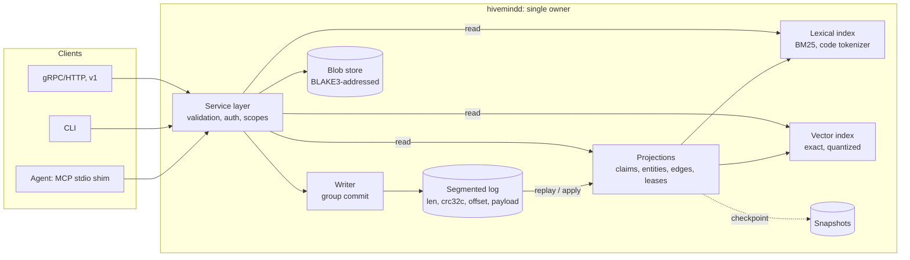

# 04: Architecture and decision record

Status: v0.2 (2026-11-10). Decisions are numbered and append-only. A reversed
decision gets a new entry that supersedes it, as the memory model prescribes.
Evidence labels follow [01](01-problem-and-goals.md#evidence-labels).

## Decision summary

| ID | Decision | Status |
|---|---|---|
| D1 | Build hivemind as one integrated, all-Rust system. Don't assemble external memory services | **Accepted** (owner, 2026-11-10) |
| D2 | Own the storage engine: a log-structured, event-sourced design written in our own crates | **Accepted** (owner, 2026-11-10); risks below |
| D3 | The append-only event log is the source of truth; every index is a rebuildable projection | Accepted |
| D4 | One daemon owns a store. Agents connect through a stdio MCP shim, a Unix socket, or (later) the network | Accepted |
| D5 | Lexical search (our own BM25, code-aware) is always on; vectors are optional and exact-first | Accepted; refined by F4 |
| D6 | No LLM on the write or read path by default. Consolidation is optional, offline, and budgeted | Accepted; refined by F6 |
| D7 | Memory is delivered as **evidence with provenance**, never as instructions; current code wins | Accepted |
| D8 | Interfaces: MCP (current spec, via `rmcp`) first, then gRPC (`tonic`). Interop with existing memory formats | Accepted |
| D9 | Distribution is staged behind explicit triggers. v0 designs in IDs, offsets, and idempotency so later stages are not blocked | Accepted |
| D10 | Dependency policy: proven crates for commodity building blocks; our own crates for the core | Accepted |

## Context

[02](02-landscape.md) and the research reports found no existing system that
covers the brief:

- **No Rust agent-memory system is ready to adopt.** The best semantics sit
  in small or dormant projects, and every published benchmark is
  self-reported ([research/01](../research/01-agent-memory-systems-rust.md)).
- **Combining components means several durability domains and runtimes:**
  for example Qdrant plus a relational store plus a Python memory framework.
  Several popular engines also have weak durability defaults
  ([research/02](../research/02-storage-and-retrieval-foundations.md)).
- **Product memory is siloed by vendor, tool, and machine, and changes
  often.** Only one product checks memories against the current code
  ([research/04](../research/04-coding-agent-memory-practice.md)).
- **Independent studies show naive memory often does not help coding agents,
  and stale memory actively hurts.** Verified experience does help
  ([research/04](../research/04-coding-agent-memory-practice.md#7-pain-points-and-failure-modes-of-todays-approaches)).

## D1: one integrated, all-Rust system

The owner's call: "I don't want to hack together weird disjoint apps/systems and
hope it works. We have way more control and room for growth doing it
ourselves."

This means a single Rust codebase and a single binary. We own:

- the data model and memory semantics;
- the storage engine;
- the indexes and retrieval;
- consolidation;
- the protocols' service layer;
- the evaluation harness.

Existing systems become **sources of ideas and baselines**, not dependencies
([02](02-landscape.md#what-we-take-from-whom)).

## D2: our own storage engine

**Decision.** hivemind's storage is a purpose-built, log-structured,
event-sourced engine in our own crates. SQLite and Tantivy are not used.

**What the research said.** Several threads advised a mature embedded store
(SQLite WAL) for v0 and warned against a custom engine. The concrete reasons
were durability bugs in young engines and the backend migrations of
coding-agent tools that lost data
([research/02](../research/02-storage-and-retrieval-foundations.md),
[research/04](../research/04-coding-agent-memory-practice.md#8-patterns-hivemind-should-adopt-or-avoid-inf-grounded-in-cited-evidence),
[research/06](../research/06-architecture-distribution-protocols-security.md)).
We record that advice and take on the risk deliberately, for three reasons:

1. **The workload is narrow.** Events are immutable and appended; state is
   derived. That is the easiest class of storage engine to get right: a
   checksummed segmented log with torn-tail recovery (Bitcask, Kafka) **[Inf]**.
   We are not building a general-purpose B-tree with in-place updates.
2. **The log is the product's spine.** Its format decides hashing, signing,
   idempotency, replication, export, and audit. Owning it avoids designing
   around another engine's file format and transaction model.
3. **Indexes need our semantics:**
   - code-aware tokenization;
   - scope- and applicability-aware filtering;
   - bitemporal metadata;
   - hippocampus-inspired retrieval experiments
     ([08](08-hippocampal-design.md)).

   Owning them is where the "room for growth" is.

**How the risk is retired:**

- **Start with the simplest correct shape.** v0 is a log plus in-memory
  projections rebuilt by replay. On-disk index segments come later, only when
  measurements require them.
- **A written durability contract and a WAL checklist**
  ([Engine design](#engine-design-v0)).
- **Crash testing before features:**
  - `kill -9` loops with acknowledged-write verification;
  - fault injection: torn tails, bit flips, short writes;
  - power-loss simulation with a fault-injecting filesystem;
  - fuzzing of the record decoder;
  - deterministic simulation as the engine grows
    ([research/09](../research/09-engine-design-techniques.md)).
- **Every projection can be rebuilt from the log.** A bug in an index is
  recoverable; only a bug in the log loses data, and the log is the smallest,
  most-tested component.
- **A data-loss bug on the log path blocks any release** (F13 in
  [07](07-falsification-experiments.md)).

## D3: the log is the source of truth

- **Every operation is an immutable event** with:
  - a UUIDv7 ID;
  - a system-assigned record time;
  - the actor;
  - an optional idempotency key;
  - a typed, versioned body.
- **Current state, lexical and vector indexes, adjacency, leases, and the
  change feed are projections:** pure functions of the log plus a projection
  version.
- **Writes return their log offset.** Offsets serve as cursors
  (`changes_since`), as read-your-writes tokens (`min_offset`), and as the
  unit of replication later.
- **Erasure (`forget`) is the only operation that rewrites history.** It is
  privileged and audited, and it purges the payload from log segments, blobs,
  and every projection.

  Precedents: Datomic, XTDB, turbopuffer, Chroma, and Milvus all use a
  log-first design
  ([research/06](../research/06-architecture-distribution-protocols-security.md#3-event-sourcing-and-cqrs-for-memory)).

## D4: one owner per store

Coding agents launch MCP stdio servers as subprocesses, so several processes
end up opening the same store. The official MCP reference memory server lost
writes this way, twice
([research/06](../research/06-architecture-distribution-protocols-security.md#42-mcp-stdio-means-many-processes-on-one-database)).
The process model:

- **`hivemindd`**, the daemon, holds an exclusive lock on the store
  directory. It is the single writer and serves many readers.
- **`hivemind mcp`** is a thin stdio shim. It finds or starts the daemon (the
  sccache pattern) and relays MCP over a Unix domain socket in a 0700
  directory with 0600 permissions.
- **The `hivemind` CLI** talks to the daemon when it is running. Otherwise it
  opens the store directly; the lock prevents two owners.
- **Embedded library mode** (`hivemind-engine` crate) serves tests and tools.
- **The daemon exits when idle.** Network listeners are off by default.

## D5: retrieval

- **Lexical search is always on.** We write our own BM25 with a code-aware
  tokenizer: it keeps raw tokens and also splits on camelCase, snake_case,
  paths, `::`, and dots. Error strings, identifiers, and versions dominate
  coding memories, and BM25 is a strong baseline on code retrieval
  ([research/07](../research/07-embeddings-and-local-inference.md)).
- **Vectors are optional.** They start as an exact scan over int8 or binary
  codes with f32 rescoring, which is feasible to about 1M vectors per scope on
  a laptop
  ([research/02](../research/02-storage-and-retrieval-foundations.md#4-brute-force-knn-feasibility)).
  ANN is added per large scope later. Embeddings run in pure Rust (candle or
  model2vec-rs); runtimes that wrap C++ stay optional. Every vector is tagged
  with its **embedding space** (model, revision, dimensions, quantization).
  Spaces are never mixed. Migrations dual-write and backfill.
- **Filters run before ranking:** scope (an authorization filter, enforced by
  the server), kind, status, applicability, and time.
- **Fusion and boosts** are explicit, versioned heuristics: reciprocal rank
  fusion, trust and verification, recency by kind, and applicability. They
  are tuned by experiments F4 and F5.
- **Responses use progressive disclosure:** cards, then detail, then
  evidence, then raw artifact ([03](03-memory-model.md#retrieval-contract-progressive-disclosure)).

## D6: no LLM on the hot path

- **Writes:** agents author structured claims. The server deduplicates and
  returns similar claims for the writing agent to resolve.
- **Reads:** deterministic retrieval.
- **LLM consolidation** (summaries, procedures, contradiction proposals) is an
  optional offline job with a token budget, an audit diff, and a taint rule:
  outputs are never more trusted than their inputs.

**Rationale:** independent results show LLM-extracted memory rarely pays off
for coding agents, and background extraction has burned very large token
budgets in practice
([research/04](../research/04-coding-agent-memory-practice.md#7-pain-points-and-failure-modes-of-todays-approaches)).
Experiment F6 tests this choice.

## D7: evidence, not instructions

- **Results are framed as evidence.** They are labeled tool output with
  provenance, trust tier, verification status, and citation-check status
  (`valid`, `drifted`, or `broken`). Tool descriptions state that **the
  current code and tests take precedence over memory.**
- **Why:** in an independent study, agents followed a stale instruction file
  over the code in 90.1% of choices. One sentence giving code precedence
  raised code-following from 4.2% to 91.4%
  ([research/04](../research/04-coding-agent-memory-practice.md#7-pain-points-and-failure-modes-of-todays-approaches)).
- **Reinforcement and expiry:**
  - A memory is reinforced only on a **validated use**, not on mere
    retrieval: a citation check passes, or feedback comes with outcome
    evidence.
  - Memories that are never reinforced decay and expire.
  - This follows GitHub Copilot Memory's retention model.

## D8: interfaces and interop

- **MCP first:** the current stateless MCP spec through the official Rust SDK,
  `rmcp`, behind our own transport adapter, because the SDK releases often.
  - **Few tools,** with deterministic ordering for prompt-cache stability.
  - **No reliance on MCP sessions, push, or stream resumability.** The change
    feed is `changes_since(cursor)`; push is an optimization
    ([research/06](../research/06-architecture-distribution-protocols-security.md#71-mcp-2026-07-28-current-stable-released-2026-07-28-v-12)).
- **gRPC** (`tonic`) for services and SDKs in v1, with a server-streaming
  `Watch(cursor)`.
- **Interop:**
  - import and export of the Copilot memory JSONL format;
  - a backend for Anthropic's client-side memory tool commands;
  - export to plain markdown for git-backed memory repositories;
  - telemetry under the OpenTelemetry GenAI conventions
    ([research/04](../research/04-coding-agent-memory-practice.md#8-patterns-hivemind-should-adopt-or-avoid-inf-grounded-in-cited-evidence)).

## D9: staged distribution

| Stage | Shape | Move on when (measured) |
|---|---|---|
| **v0, local** | One daemon per machine, one store per tenant, single writer, our log, in-memory projections, snapshots | Two or more machines or people need the same project memory, or cloud-sandboxed agents need access |
| **v1, shared service** | The same binary serving MCP over Streamable HTTP and gRPC with OAuth 2.1. One partition (log) per tenant. Laptops sync their own events through an idempotent upload queue and pull by cursor (the PowerSync pattern). Continuous backup by shipping log segments | An availability target that one node plus restore from shipped segments can't meet; a working set larger than one node; write rate above one writer per partition after batching |
| **v2+, distributed** | Immutable log segments in object storage with a compare-and-swap commit pointer, stateless query nodes, and Raft only for metadata and leases | Triggers above, re-measured |

Built into v0 so that later stages are not blocked:

- UUIDv7 IDs and BLAKE3 content hashes;
- per-partition offsets as the universal cursor;
- idempotency keys on every write;
- a canonical, versioned event encoding;
- payloads separable from envelopes, for erasure;
- reserved fields for signatures and hybrid logical clocks;
- fencing tokens on leases;
- a transport-independent service layer.

These follow
[research/06](../research/06-architecture-distribution-protocols-security.md#design-these-into-v0-so-later-stages-arent-blocked).
Immutable events merge as a set union across replicas. Leases can never be
merged offline and always need one authority.

## D10: dependency policy

**Ours, in our own crates:**

- the log and segment format;
- the blob store;
- the projections and snapshots;
- the lexical index and tokenizer;
- the vector index and quantization;
- the adjacency and temporal metadata indexes;
- retrieval and ranking;
- the belief policy;
- consolidation;
- the service layer;
- the evaluation harness.

**Proven crates** (each recorded with version and reason in `Cargo.toml`
comments where it isn't obvious):

| Area | Crates |
|---|---|
| Checksums and hashing | `crc32c`, `blake3` |
| Serialization | `serde`, `serde_json` (v0 event encoding; revisited in [research/09](../research/09-engine-design-techniques.md)) |
| IDs and versions | `uuid` (v7), `semver` |
| Errors | `thiserror` |
| CLI | `clap` |
| Concurrency and runtime | `parking_lot`, `tokio` (daemon and network only) |
| Protocols | `rmcp`, `tonic` |
| Numerics | `half`, `bytemuck`, and a SIMD kernel crate when vectors land |
| Testing | `proptest`, `tempfile` |

Any C or C++ dependency needs a recorded exception.

## Engine design (v0)



### On-disk layout

```text
<store>/
  LOCK                         # exclusive lock held by the owning process
  MANIFEST                     # format version, store ID, created_at (atomically replaced)
  log/00000000000000000000.hlog
  log/00000000000000041823.hlog  # segments named by their first offset
  blobs/ab/cdef…               # BLAKE3-addressed artifacts
  blobs/tmp/                   # staging for atomic blob writes
  snapshots/                   # projection checkpoints, added when replay time requires them
```

### Log records

```text
segment header (32 B): magic "HMLOG\0\0\1" | format u32 | reserved u32 | base_offset u64 | header crc32c u32 | pad
record:                len u32 | crc32c(len ‖ first_offset ‖ count ‖ payload) u32
                       | first_offset u64 | count u32 | payload[len]
payload:               count × (event_len u32 ‖ event bytes)
event bytes:           codec u8 (1 = JSON v1) ‖ encoded event
```

Format freeze for the first release tag: `SEGMENT_FORMAT = 1`,
`JSON_V1 = 1`, golden fixtures under
`crates/hivemind-engine/tests/fixtures/`. Residual LazyFS / power-loss CI:
[f13-crash-injection.md](f13-crash-injection.md).

### Durability contract (v0)

1. **A write is acknowledged only after its record is fsynced.** On macOS
   that means `F_FULLFSYNC`, which Rust's `File::sync_all` issues
   ([research/02](../research/02-storage-and-retrieval-foundations.md#24-kv-engines)).
   Concurrent writes share one fsync through group commit.
2. **New segment files and blobs are durable before they are referenced:**
   write to a temporary file, fsync it, rename it, then fsync the directory.
   - Storing a blob that already exists also flushes its directories, since
     another writer's rename may not be durable yet.
   - The store directory is flushed after `log/` and `blobs/` exist.
   - The MANIFEST is written **last**, so a MANIFEST whose log is missing is
     an error, never a silently empty store.
3. **Nothing is acknowledged that replay couldn't decode.** Each encoded event
   is decoded before it is appended, so an accepted write can never leave a
   store that refuses to reopen.
4. **Recovery:**
   - Records are scanned in order, checking each checksum and that offsets
     are contiguous.
   - A torn or invalid tail in the **last** segment is truncated, fsynced, and
     recorded as a `recovered` event in the log. The CLI also warns about it.
   - Corruption anywhere else stops the open with a precise error. A
     separate `repair` command handles it; recovery never repairs silently.
5. **Projections are never trusted over the log.** At startup they are rebuilt
   from the log, or loaded from a snapshot that records its offset and is
   verified against the log.
6. **A `--no-fsync` mode exists for tests and benchmarks only,** and its
   output is labeled as such.

### Projections (v0, in memory)

| Projection | Structure |
|---|---|
| Claims | Dense table indexed by internal document ID, plus a map from ID to row. Holds status, supersession links, scope, applicability, provenance, and counters |
| Entities and scopes | Postings from entity key or scope to document IDs |
| Edges | Adjacency lists (supports, contradicts, supersedes, derived_from, about) |
| Lexical | Term dictionary and postings with term frequencies, document lengths, BM25 statistics |
| Vectors | Contiguous per-space arrays (f32, plus int8 or binary codes) |
| Coordination | Leases with fencing tokens; idempotency keys |

Memory budget at 100k claims, excluding vectors: tens of MB **[Inf]**. On-disk,
memory-mapped index segments are the growth path once replay time or RSS
breaks the targets in [01](01-problem-and-goals.md#provisional-targets-hypotheses-to-test-not-commitments).

### Read and write paths

- **Write:**
  1. Validate against the current state under the writer lock.
  2. Encode and append, then fsync.
  3. Apply to the projections.
  4. Reply with `{ids, offset, similar}`.

  Validation and apply happen under the single writer lock, so no other write
  can interleave between them.
- **Read:**
  1. Take a read lock on the projections, with an optional `min_offset` wait.
  2. Generate candidates through the lexical and vector indexes.
  3. Filter by scope, status, kind, and applicability.
  4. Rank and fit to the token budget.
  5. Return cards.

## Risks

| Risk | Mitigation | Retired by |
|---|---|---|
| A data-loss bug in our log | Small log surface; WAL checklist; kill-9, fault-injection, and power-loss tests; decoder fuzzing | F13 (blocks release) |
| Replay time and RSS grow with the corpus | Snapshots, then memory-mapped immutable index segments | E-S startup and footprint benchmarks |
| Our BM25 or vector index underperforms established engines | Compare against an off-the-shelf reference on the same queries | F4 (recall and latency against a reference) |
| Scope creep into a general database | Workload-specific engine; non-goals in [01](01-problem-and-goals.md#non-goals-for-the-first-version) | Design review |
| Memory doesn't improve outcomes | Evaluation harness from the start; baselines including git-markdown memory | F1–F3 |
| Poisoning through shared memory | Trust tiers, taint, quarantine, server-side ACLs, redaction, audit | F12 |
